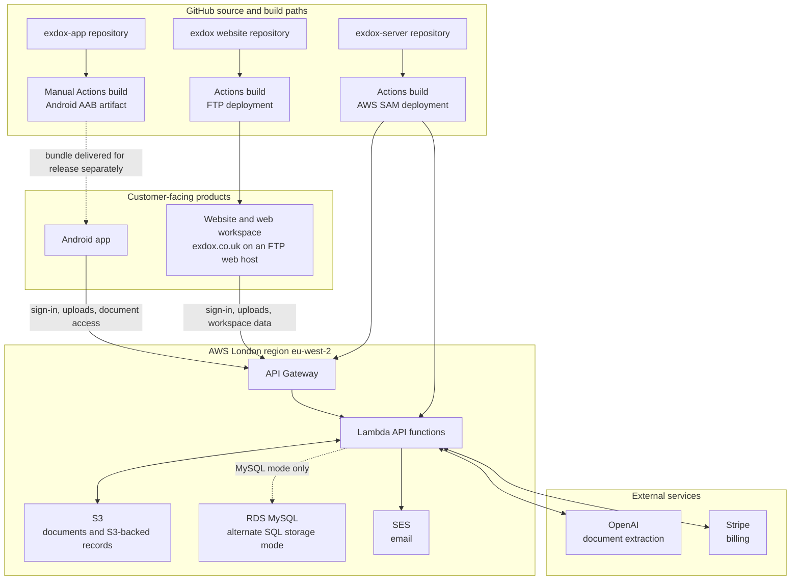

# Exdox system architecture

This diagram shows the main customer path and the source-to-deployment path as recorded in the repositories on 10 November 2026. It is a source-based architecture view, not a live infrastructure inventory.

## Reading the diagram

- Solid arrows show the main request or deployment path. The dotted RDS arrow is an alternate code path, and the dotted Android arrow shows that building an AAB does not itself publish an app update.
- The website deploy workflow builds the React/Vite site and transfers `dist/` to an FTP web host on pushes to `main`.
- The server deploy workflow builds the Node.js/TypeScript API and deploys the AWS SAM stack to London on pushes to `main`.
- The app repository has a manually triggered GitHub Actions workflow that builds an Android AAB artifact; release to users is a separate step.
- The website and Android app both point to the London API Gateway endpoint in their checked-in configuration. Production storage has been recorded as `ReceiptStoreMode=s3`; confirm the current AWS setting before treating that as live fact.

Sources: `exdox/.github/workflows/deploy.yml`, `exdox/src/api.ts`, `app/.github/workflows/build-android-bundle.yml`, `app/src/services/auth.ts`, `server/.github/workflows/deploy.yml`, `server/infra/template.yaml`, `server/src/aws/shared/env.ts`, and workspace `PROJECT.md`.
